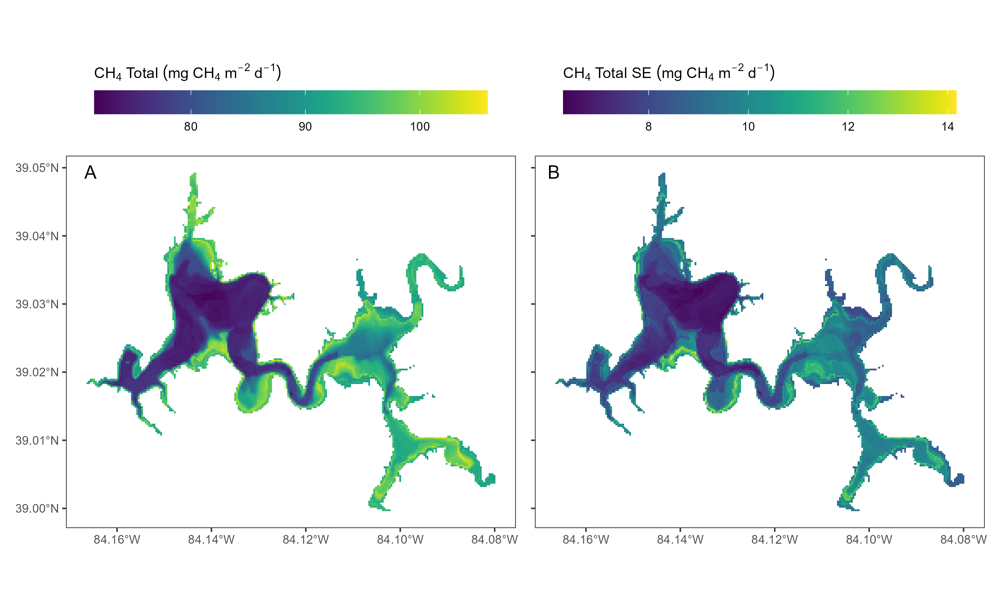

```{r setup, include=FALSE}
knitr::opts_chunk$set(echo = FALSE)
# libraries specified in tar_quarto call in _targets.R. Annoyingly,
# tar_quarto ignores tar_option_set
library(targets)
library(tidyverse)
library(tidymodels) # glance
library(flextable) # tables
library(english) # numeric to text
library(tidyterra) # harsha lake map
library(terra) # harsha lake map
```

```{r data, message=FALSE}
# load whatever data objects are needed
targets::tar_load(dat_raw)
targets::tar_load(dat_trans)
targets::tar_load(emissions_lake_data)
targets::tar_load(modeling_vars)
targets::tar_load(table1_object)
targets::tar_load(lake_scale_percent_ebul)
targets::tar_load(random_forest_object)
targets::tar_load(interaction_results)
targets::tar_load(table2_dat)
targets::tar_load(map_figure)
targets::tar_load(predicted_observed_plot)
targets::tar_load(variable_importance_plot)
targets::tar_load(partial_dependence_plots)
targets::tar_load(interaction_plots)
targets::tar_load(harsha_pred_map)
targets::tar_load(s_n)
```

## Introduction

Reservoirs are important sources of CH~4~ to the atmosphere. Recent estimates suggest that they contribute \~3.5% of global CH~4~ emissions and are responsible for \~50% of the anthropogenic freshwater source, yet their contribution is not well constrained[@canadell_etal_2021; @rosentreter_etal_2021; @saunois_etal_2025]. Specifically, after controlling for variation in the global reservoir surface area, global estimates of CH~4~ emissions from reservoir water surfaces vary by more than threefold, from 4.8 to 18.7 Tg yr-1[@lauerwald_etal_2023], with an additional 6.7 to 37.1 Tg yr-1 from degassing at dam turbines [@harrison_etal_2021].

Some of the uncertainty in upscaled CH~4~ emission estimates from reservoirs is due to the challenge of accurately quantifying CH~4~ emissions from a given water body. Methane can be emitted to the atmosphere via multiple pathways, including diffusion, ebullition (bubbling), degassing, and translocation through emergent vegetation. However, all of these CH~4~ emission pathways are rarely measured in a given water body [@jager_etal_2022] and emissions are often quantified using different methodologies, complicating upscaling efforts and attempts to compare emission estimates from different water bodies [@saunois_etal_2025]. Methane emission rates also vary at multiple temporal (i.e., diel, seasonal, interannual) and spatial (i.e., within and among reservoirs) scales (***citations***). For example, CH~4~ ebullition is a highly variable emission pathway that is difficult to capture with traditional sampling techniques (***citations***). Studies often find that ebullition is higher at shallow depths (\~ \<10 m) due to low hydrostatic pressure, allowing bubbles to rise to the water surface (***citations***). However, even within shallower areas, ebullition is highly sporadic, and ***many samples are needed to reduce uncertainty and more accurately quantify this process***. Improving estimates of CH~4~ emissions will require greater spatiotemporal resolution sampling measuring multiple CH~4~ emission pathways from more water bodies using standardized techniques.

Reducing uncertainty and improving prediction of CH~4~ emissions can also be accomplished by furthering understanding of the underlying drivers of CH~4~ production, oxidation, and emission from water bodies. Many studies have examined drivers of CH~4~ production and emission. Methane production via methanogenesis occurs under warm, anoxic, and organic-matter rich conditions in lakebed sediments (***but see aerobic methane production pathways***) during stratification, and often, the factors that drive CH~4~ production are also related to CH~4~ emission rates. Methane emissions are often higher from eutrophic lakes. After autochthonous organic matter production fueled by nutrient-rich conditions senesces and sinks vertically to the lakebed, it provides a source of highly labile organic matter for methanogens (citations). Methane ebullition is often higher in shallower waters and in areas with greater organic matter availability and anoxic conditions (and after turnover). Findings from many studies have been synthesized to produce models that predict CH~4~ emissions (e.g., [@prairie_2021] \[G-Res\], [@delwiche_etal_2022] \[ResMe\]); but predictors are poorly constrained as they are developed based on data collected via different methodologies and from small populations of lakes and reservoirs. Hence, there is a need for comprehensive studies that apply uniform methodology across a large number of reservoirs that vary in characteristics to better constrain estimates of CH~4~ emission rates and improve model predictions.

In this study, we carried out a comprehensive assessment of CH~4~ emissions from 146 reservoirs, comprising over 2000 individual measurements, across the conterminous US that ranged in size and trophic status. Our aims were to improve understanding of the patterns and drivers of CH~4~ emissions from reservoirs for improved prediction at local to regional scales. We utilized uniform methodology to measure CH~4~ diffusion and ebullition at multiple locations in each of the 146 reservoirs in summer and also collected multiple physicochemical measurements to build predictive relationships. We also collected driver variables from available multiple data layers (e.g., lake productivity, area, etc.) to examine whether our local model vs a model developed from spatial datalayers and model outputs could be used to predict CH~4~ emissions.

## Methods

### Data sources

We used a data set from the Survey of Reservoir Greenhouse gas Emissions (SuRGE) project containing methane emission rates measured at `r dat_trans %>% group_by(lake_id) %>% summarize(n_site = n()) %>% {min(.$n_site)}` to `r dat_trans %>% group_by(lake_id) %>% summarize(n_site = n()) %>% {max(.$n_site)}` locations within 146 US reservoirs [@beaulieu_et_al_2026]. One hundred and eight reservoirs were selected using a generalized random-tessellation (GRTS) design [@stevens_et_al_2004] and represent a spatially balanced and representative sample of reservoirs across the conterminous United States (CONUS). Thirty two of the reservoirs were selected to encompass a land use and maximum depth gradient across Ohio, Kentucky, and Indiana [@beaulieu_et_al_2020]. The remaining `r 146-108-32 %>% as.english(.)` reservoirs were selected based on special interest (e.g. reference sites, location of related research). Sampling sites within each reservoir were selected using a GRTS design. In some cases the GRTS design included stratification to ensure the placement of sampling sites in areas where high emission rates were expected (e.g. river inflow regions). All reservoirs were sampled once during the summers of 2016-2023, with `r dat_trans %>% filter(visit == 2) %>% distinct(lake_id) %>% {nrow(.)} %>% as.english(.)` reservoirs revisited a second time.

```{r map_figure, echo=FALSE, message=FALSE, warning=FALSE}
#| fig-align: center
#| fig-cap: "Figure 1. Locations of reservoirs included in this study across the conterminous United States and Puerto Rico (a). Inset shows higher density of waterbodies sampled in Ohio, Indiana, and Kentucky (b). In both panels, color and size of points indicate total lake-wide CH~4~ emission rates."
#| fig-cap-location: bottom
#| fig-height: 6
#| fig-width: 11
#| out-width: 100%

# plot variable_importance_plot
map_figure


```

Diffusive CH~4~ emission rates were measured using short-term (`r min(dat_trans$ch4_deployment_length, na.rm = TRUE)` - `r max(dat_trans$ch4_deployment_length, na.rm = TRUE)` seconds) floating chamber deployments. Ebullitive CH~4~ emissions were measured using inverted funnels deployed for `r dat_trans %>% mutate(duration = trap_rtrvl_date_time - trap_deply_date_time) %>% {min(.$duration, na.rm = TRUE)} %>% as.numeric(.) %>% round(., digits = 1)` - `r dat_trans %>% mutate(duration = trap_rtrvl_date_time - trap_deply_date_time) %>% {max(.$duration, na.rm = TRUE)} %>% as.numeric(.) %>% round(., digits = 1)` hours. Vertically resolved temperature and dissolved oxygen profiles, nutrient concentrations (nitrogen, phosphorus, carbon, sulfate), and chlorophyll-*a* (extraction-based) were measured at the deepest sampling site in each reservoir. Basic physicochemistry parameters (temperature, dissolved oxygen, pH, optical sensor based chlorophyll-*a*) and water depth were measured at all sites. See Beaulieu et al (2026) for full methodological details.

In addition to variables measured during the sampling campaign, the SuRGE dataset contains numerous predictor variables derived from external sources. Reservoir age was derived from the National Inventory of Dams [@usace_2025], sediment carbon content and water residence time were retrieved from the 2017 National Lakes Assessment [@usepa_2022], landscape and mean annual climate variables (e.g. watershed size, soil organic matter content, mean annual precipitation) were retrieved from lakeCat [@hill_et_al_2018], meteorology variables corresponding to the time and location of the emission rate observation were retrieved from ERA5-Land [@era5_2021], and remotely sensed trophic status estimates were retrieved from LAGOS [@hanly_et_al_2025]. Given the potential for light to influence emissions via the inhibition of methanotrophy [@thottathil_2018], we supplemented the SuRGE dataset with shortwave radiation data accessed using Free Weather API (https://open-meteo.com) which is a wrapper for ERA5-Land. Shortwave radiation was calculated as the sum of radiation during the duration of our observations in units of XX.

While sulfate and chlorophyll-*a* samples were collected for the majority of national SuRGE reservoirs, sulfate was not collected in the 2016 regional survey nor in the early (2020) national survey sites, and chlorophyll-*a* was not measured at a subset of the 2016 regional survey sites. Because missingness would limit our statistical power, and because early analysis suggested that both of these variables may be important predictors, we added auxiliary data for missing sulfate (n = `r dat_raw %>% filter(is.na(so4_shallow)) %>% distinct(lake_id) %>% {nrow(.)}`) and extraction-based chlorophyll-*a* (n = `r dat_raw %>% filter(is.na(chla_lab_shallow)) %>% distinct(lake_id) %>% {nrow(.)}`) concentrations with values obtained from state (e.g. Ohio Department of Natural Resources) or federal (US Army Corps of Engineers, EPA's National Lakes Assessment) monitoring programs. Preference was given to values measured during the same month and year of the emission rate measurements, else the mean of all available data was used. Potential error from assigning missing observations with values from external data sources was assessed by comparing values measured during the SuRGE campaign to those measured during the 2017 and 2022 National Lakes Assessments [@usepa_2022; @usepa_2024] in lake where both values were available. The pearson correlation coefficient (*r*) among chlorophyll-*a* measurements was `r dat_raw %>% select(chla_lab_shallow, nla17_chla, nla22_chla) %>% distinct %>% pivot_longer(!chla_lab_shallow) %>% {cor(.$chla_lab_shallow, .$value, use = "complete.obs") %>% round(digits = 2)}`. Sulfate showed much less temporal variability with an *r* value of `r dat_raw %>% select(so4_shallow, nla17_sulfate, nla22_sulfate) %>% distinct %>% pivot_longer(!so4_shallow) %>% {cor(.$so4_shallow, .$value, use = "complete.obs") %>% round(digits = 2)}`.

### Predictor variables and modeling approach

Predictor variables representing reservoir morphometry, tropic status, climate, hydrology, watershed, and chemical patterns were selected for use in modeling **(Table 1)**. Variables within each group were assessed for collinearity using variance inflation factor (VIF) values\[a\] [@montgomery_peck_1992]. Variables with the greatest VIF were removed until all variables had a VIF less than three. The final collection of variables used in each model were screened for collinearity using the same approach. Several morphological variables were collinear and we chose *a priori* to include surface area as a predictor while omitting all other morphological variables with a VIF \> 3 including dynamic ratio and shoreline complexity. We also excluded circularity as a predictor, despite its relatively low VIF value, given counterintuitive relationships where partial dependence plots showed emissions increasing with circularity. We expect this prediction was likely due to the negative relationship between circularity and surface area (pearson correlation coefficient = 0.5; smaller reservoirs are more round), as has been reported elsewhere [@casas_ruiz_2021]. To avoid imputing missing values during modeling, we also excluded some variables that were originally compiled [@beaulieu_et_al_2026], but had high missingness. The final set of variables used in the models are presented in **Table 1**.

Random forest models were constructed for each response variable (diffusive, ebullitive, and total CH~4~ emission rates) using two approaches. The first model set used predictors that are consistently available in national databases. The second set of models supplemented, or replaced, the national predictors with those directly measured during the sampling campaign. For example, the national model included remote sensing estimates of *in-situ* chlorophyll-*a*, which are widely available for the US [@hanly_et_al_2025], whereas the local-measurement model used direct measurements of chlorophyll-*a*. For the local-measurement model, estimates of reservoir morphology (surface area, maximum depth, mean depth, and littoral fraction) were informed by in-situ measurements of site depth and field . For the national model, we estimated maximum depth, mean depth, and littoral fraction using globathy (n=126), the National Hydrography Dataset (n=13), lagos (n=5), the National Lakes Assessment 2010 (n=1) and the EPA National Lakes Assessment 2017 (n=1). We estimated surface area using the National Hydrography Dataset (n=143) and Hydrolakes (n=3).

Comparison of these two sets of models was used to determine how much prediction accuracy improves when investigators expend the resources to conduct an "on the ground" investigation, rather than relying exclusively on widely available, but not *in-situ*, data. **Table 2** reports the total number of observations included in each model, wherein sites with any missing values were removed from the data set prior to modeling.

```{r}
#| label: table_1
#| tbl-cap: "Table 1. Variables used in Random Forest model."

table1_object 
```

Random forests [@breiman_2001], a machine learning technique, were used to relate CH~4~ emission rates (diffusive, ebullitive, total) to predictor variables **(Table 1)**. This method was chosen because it can accommodate non-linear relationships, interactions, and collinearity among predictor variables, all of which are present in the data. Random forests are a collection of regression trees, where each tree is trained on a bootstrapped sample of the data and predictors. Predictions from the random forest model are an average of the predictions across the individual trees. Model error for each tree in the random forest is quantified by comparing the observations that were withheld from each tree by the bootstrap sampling procedure, to the value predicted for those observations. These prediction errors are averaged across the ensemble of trees and reported as the out-of-bag (OOB) model error.

The relative importance of predictor variables was ranked using the permutation variable importance method [@breiman_2001; @wright_et_al_2016]. Permutation variable importance is calculated using a two-step method. In the first step, the OOB performance is calculated for each tree. In the second step, the values for the predictor variable of interest are randomly permuted, and the OOB performance recalculated. The difference between the two OOB values is the permuted importance for the variable of interest. This procedure is repeated for each variable and the permuted importance values averaged across all trees. Relationships between response and predictor values were further investigated using partial dependence plots (PDPs) which show the marginal effect of a single predictor on the response while accounting for the average effect of the other predictors in the model [@friedman_2001]. Model prediction error was assessed using the coefficient of determination (r^2^) between observed and predicted values, mean square error (MSE) and root mean square error (RMSE). We also calculate the mean absolute error (MAE) because it is less influenced by outliers than MSE and RMSE. All estimates of prediction error were calculated using OOB predictions.

Response variables were log transformed to optimize model fitting and prediction because non-constant variation across regression tree residuals gives greater weight to higher variance data [@death_fabricius_2000]. Random forest modeling was conducted using the ranger package [@wright_ziegler_2017] in R version 4.5.1 [@r_core_team_2025] with four predictor variables randomly sampled at each split (mtry argument), a minimum of five observations per node (min.node.size argument), and a total of 500 trees per random forest (num.trees argument).

## Results

Spatial patterning in CH~4~ emission rates across the US highlights the heterogeneity in total emission rate and proportion of diffusion versus ebullition within and across eco-regions **(figure 1)**. Notably, the proportion of total CH~4~ emissions at the lake-scale from ebullition (compared to diffusion) generally increased from west to east (r = `r cor(lake_scale_percent_ebul$long, lake_scale_percent_ebul$percent_ebul, use = "pairwise.complete.obs") %>% round(2)`), with low ebullition contributions in the western US, that increased in the central US, midwest, to Atlantic coast **(figure S1A)**. While two key drivers that would promote ebullition in lieu of diffusion – SO~4~ and mean depth – both showed decreases from west to east (r = `r cor(lake_scale_percent_ebul$long, lake_scale_percent_ebul$so4_shallow, use = "pairwise.complete.obs") %>% round(2)`, r = `r cor(lake_scale_percent_ebul$long, lake_scale_percent_ebul$mean_depth, use = "pairwise.complete.obs") %>% round(2)`, respectively). However, only SO~4~ was clearly related to the ebullition percent contribution (r = `r cor(lake_scale_percent_ebul$so4_shallow, lake_scale_percent_ebul$percent_ebul, use = "pairwise.complete.obs") %>% round(2)`; **figure S1B**). SO~4~ was higher in the western US and associated with much lower ebullition percent contribution (i.e., greater diffusive contribution), whereas lower SO~4~ (\< \~100 mg L^-1^) that was more common in the central to eastern US had a wide range of ebullition percent contribution, including most of the lakes with 75-100% of total CH~4~ emissions from ebullition.

The OOB r^2^ of the local random forest models, when evaluated on the log-transformed response scale, ranged from `r table2_dat %>% filter(model_var_set == "local_vars_all") %>% {round(min(.$r2_log), 2)}` to `r table2_dat %>% filter(model_var_set == "local_vars_all") %>% {round(max(.$r2_log), 2)}` and were, on average, `r table2_dat %>% select(response, model_var_set, r2_log) %>%  pivot_wider(names_from = model_var_set, values_from = r2_log) %>% mutate(diff = local_vars_all - global_vars) %>% summarize(mean_diff = mean(diff)) %>% pull %>% round(., 2)` greater than the corresponding national model **(table 2)**. When the OOB predictions were backtransformed to the linear scale and compared to the observations, the OOB r^2^ were considerably lower for both local (mean r^2^ = `r table2_dat %>% filter(model_var_set == "local_vars_all") %>% {round(mean(.$r2_linear), 2)}`) and national (`r table2_dat %>% filter(model_var_set == "global_vars") %>% {round(mean(.$r2_linear), 2)}`) models **(figure 2)**. Measures of prediction error (MSE, RMSE, MAE) for the global model, when based on log-transformed predictions, were greater than those for the local models, but were very similar, and in some cases even lower than those for the local model, when assessed at the scale of the untransformed response.

```{r model_performance, echo=FALSE, warning=FALSE, message=FALSE}
#| tbl-cap: "Table 2. Performance metrics for Random Forest models"
 
table2_dat %>%
  flextable(.) %>%
  theme_booktabs() %>%
  fontsize(size = 8, part = "all") %>%
  padding(padding = 0, part = "all") %>% # Set all padding to 0 points
  line_spacing(space = 1, part = "all") %>%   # Set line spacing to single space (1)
  merge_v(j = ~response) %>%
  fix_border_issues() %>%
  colformat_double(j = c("mse_log", "rmse_log", "mae_log"), digits = 3) %>%
  colformat_double(j = c("r2_log", "r2_linear"), digits = 2) %>%
  colformat_double(j = c("mse_linear", "rmse_linear", "mae_linear"), digits = 0) %>%
  compose(
    part = "header",
    j = "r2_log",
    value = as_paragraph("OOB r", as_sup("2"), " log")
  ) %>%
  compose(
    part = "header",
    j = "r2_linear",
    value = as_paragraph("OOB r", as_sup("2"), " linear")
  ) %>%
  hline(
    i = c(2,4,6),
    part = "body"
  ) %>%
  autofit()

```

```{r space}
#| results: asis

# force empty space between table and figure
cat("\n\n")
```

```{r pred_obs, echo=FALSE, warning=FALSE, message=FALSE}
#| fig-width: 6
#| fig-height: 3
#| fig-align: "center"
#| out-width: "80%"
#| fig-cap: "Figure 2. Predicted versus observed diffusive emission rates in A) log and b) linear scales."
#| fig-cap-location: bottom

# plot predicted vs observed
predicted_observed_plot


```

Variable importance plots

```{r var_imp, echo=FALSE, message=FALSE, warning=FALSE}
#| fig-align: "center"
#| fig-cap: "Figure 3. Relative variable importance for random forest models for local models for CH~4~ total, CH~4~ diffusion, and CH~4~ ebullition. Explanatory variables on the y-axis are presented in descending order of importance from the CH~4~ total model. Note that some explanatory variables are not used in all models, and lines are empty when not included. ^a^only used in CH~4~ diffusion and CH~4~ ebullition models, ^b^only used in CH~4~ diffusion model, and ^c^only used in CH~4~ ebullition model."
#| fig-cap-location: bottom
#| fig-height: 5
#| fig-width: 8
#| out-width: "80%"

# plot variable_importance_plot
variable_importance_plot


```

Partial dependence plots

```{r pdp, echo=FALSE, warning=FALSE, message=FALSE}
#| fig-width: 8
#| fig-height: 6
#| fig-align: "center"
#| out-width: "80%" 
#| fig-cap: "Figure 4. Partial dependence plots for most important and additional selected explanatory variables for local models for CH~4~ total (green), CH~4~ diffusion (orange), and CH~4~ ebullition (purple). Note that surface area is presented with a log-transformed x-axis."
#| fig-cap-location: bottom

# plot partial dependence plot   
partial_dependence_plots


```

Interaction plots

```{r interaction_plots, warning=FALSE, message= FALSE}
#| fig-width: 5
#| fig-height: 4
#| fig-align: "center"
#| out-width: "80%" 
#| fig-cap: "Figure 5. Interaction plot for mean depth x sediment C for local model of CH~4~ total. Interaction strength was estimated as the difference in emission rate range across the range of sediment C when mean depth was low versus high (difference emission rate range between red lines), and similarly the difference in emission rate range across the range of mean depth with sediment C was low versus high (difference in emission rate range between blue lines)."
#| fig-cap-location: bottom

# plot interaction plots (3)   
interaction_plots

```

Harsha prediction map:



## Discussion

### Morphometry

Measures of reservoir morphometry were important predictors of CH~4~ emission rates across all models, which is consistent with previous work at global [@deemer_2021], regional [@west_2016], and site-specific scales [@desrosiers_2022]. The models utilizing predictors measured on-site (“local models” hereafter) identified mean reservoir depth as the second most important predictor **(Figure 3)**, with all emission pathways (diffusion, ebullition, total) exhibiting a steep, non-linear decline in emission rates with increasing depth. Diffusive emission rates fell sharply as mean reservoir depth increased from a minimum of `r dat_trans %>% {min(.$mean_depth, na.rm = TRUE)}`, the shallowest waterbody in the dataset, to about 2.5 m, with very low emission rates beyond depths of about 12 m **(Figure 4)**. These depth thresholds roughly align with a recent global study that estimated 85% of diffusive CH~4~ fluxes originate from lakes with a mean depth \<5 m [@li_2020]. This pattern may reflect the relatively greater abundance of vegetated littoral zones, a known hot spot for CH~4~ production **\[CITATION\]**, in shallower reservoirs [@delsontro_2018; @desrosiers_2022]. This explanation is supported by the random forest models which identified the fraction of the waterbody \<3 m deep, a functional definition of the littoral zone, as the single most important predictor of CH~4~ emission rates. \[b\]\[c\]While mean reservoir depth was an important predictor of diffusive emission rates, site-specific depth measurements were overall much less important. This may be because dissolved CH~4~, which drives diffusive emissions, can be widely advected throughout a waterbody. For example, CH~4~ produced in littoral sediment can be advected to the center of deep waterbodies before diffusing across the air-water interface [@delsontro_2018], thereby decoupling the depth of CH~4~ production from the depth of CH~4~ emission. By contrast, ebullitive emissions occur at the site of CH~4~ production and the random forest identified site-depth as the third most important predictor for this emission pathway. Deeper depths result in more methane dissolution as bubbles rise further distances before eventually reaching the atmosphere. Together with initial bubble size, the water depth determines the fraction of methane in the original bubble that ultimately reaches the atmosphere [@mcginnis_2006]. The random forest predicts a steep decline in ebullition, with very minimal bubbling at depths deeper than \~10m.

Total CH~4~ emission rates reflect the sum of diffusive and ebullitive emission rates, thus the factors controlling total emission rates are a blend of those controlling diffusion and ebullition. Site depth was not identified as an important predictor of total CH~4~ emission rates, likely because, on average, diffusion contributed more to total emissions than ebullition **\[VERIFY THIS\]** (diffusion was greater than ebullition at `r dat_trans %>% mutate(diff_greater = ch4_diffusion > ch4_ebullition) %>% group_by(diff_greater) %>% summarize(counts = NROW(diff_greater)) %>% filter(!is.na(diff_greater)) %>% pivot_wider(values_from = counts, names_from = diff_greater) %>% rename("less" = 1, "great" = 2) %>% mutate(percent = great / (great + less)*100) %>% pull(percent) %>% {round(., 1)}`% of sites). Our random forest model predicts a steep decline in total emission rates as depth increases to approximately 5 m. 5 m was recently proposed as a threshold above or below which lakes, ponds and wetlands show non-linear changes in a variety of ecosystem metrics, although no such threshold was found specifically for methane [@richardson_2022].

The importance of mean reservoir depth was also apparent in the models restricted to predictor variables that are widely available across the US (“national model” hereafter). Estimates of mean depth are available for many US waterbodies in the NHDPlusV2 database and across the globe in the GLOBathy data set [@khazaei_2022]. At the global scale, previous work has found maximum depth to be a more informative predictor of total emissions, but this was based on a very small sample size (n=9 reservoirs, [@deemer_2021]). Due to strong collinearity among morphological variables, maximum depth was excluded from our national models.

All emission pathways exhibited a non-linear, negative relationship with reservoir surface area, the fourth most important predictor in all local models and the most important predictor in the diffusive emission rate national model. This result reinforces reports from numerous studies showing correlations between surface area and measures of CH~4~ biogeochemistry including emission rates and dissolved concentration [@casas_ruiz_2021; @beaulieu_et_al_2020; @rasilo_et_al_2015]. Attributing a mechanism to this correlation is difficult because of strong collinearity among indices of reservoir size and shape. We decided *a priori* to include surface area as a predictor in the RF models and excluded all other morphology indices with a VIF \> 3; however, replacement of surface area with excluded variables, including shoreline complexity and dynamic ratio, results in models with nearly identical predictive accuracy (**SI TABLE XX**), but different mechanistic interpretations. Surface area therefore serves as a proxy for several morphological indices and the correlation with CH~4~ emission rates is likely driven by a combination of mechanisms including a tendency for smaller reservoirs to be shallower, more likely to develop an anoxic hypoxia due to higher sediment-to-volume ratios, and to have stronger connections between littoral and pelagic zones. The novel contribution of our finding is that it is supported by observations from the largest, most diverse, and most geographically distributed set of reservoirs that has been analyzed to date, demonstrating that reservoir morphology plays a critical role in regulating CH~4~ biogeochemistry.

Relative drainage area (RDA), calculated as the ratio of watershed to reservoir surface area, serves as a proxy for the per-unit-area loading rate of watershed derived sediment into a reservoir (i.e., g sediment m^-2^ d^-1^) and has been shown to correlate with reservoir CH~4~ emission rates [@beaulieu_et_al_2020]. RDA was identified as the fourth most important predictor in the national models of CH~4~ total and diffusion, but was not selected as an important variable in any of the local models, possibly because the local models also include measurements of sediment organic matter (third most important predictor in the total and diffusive local models) which may serve as a stronger index of carbon availability than RDA.

### Carbon

The relationship between total and diffusive methane emissions and sediment carbon is consistent with the notion that most methane is produced within reservoir sediments [@bastviken_2008] and that higher concentrations of sediment carbon will fuel methanogenesis [@bodmer_2025]. One study across 72 aquatic systems found that sediment methane production potential was strongly related to the percent organic carbon in the sediments, while also noting that reservoirs tended to have higher sediment methane production potential than natural lakes [@bodmer_2025]. While sediment C concentrations may be highly variable within a reservoir [@berberich_2019], the National Lakes Assessment (NLA) measurements used here specified that sediment carbon be collected from the index site, which is defined as the deepest point near the middle of the reservoir \<50m. Thus, the NLA sediment C represents a spatially consistent metric of sediment C availability. The response of CH~4~ emission rates to increasing sediment carbon availability is constrained by depth, however, with shallow reservoirs responding more strongly than deep systems\[d\]\[e\] **(Figure 5)**. Here, when mean depth was at its shallowest, total CH~4~ emission rates increased by `r interaction_results[[1]] %>% filter(group %in% c(1, 50)) %>% group_by(group, var1_name) %>% summarize(range_ch4 = expm1(max(yhat)) - expm1(min(yhat))) %>% pivot_wider(values_from = range_ch4, names_from = group) %>% pull(3) %>% {round(., 1)}` mg CH~4~ m^-2^ h^-1^ as sediment C increased, compared to an increase of only `r interaction_results[[1]] %>% filter(group %in% c(1, 50)) %>% group_by(group, var1_name) %>% summarize(range_ch4 = expm1(max(yhat)) - expm1(min(yhat))) %>% pivot_wider(values_from = range_ch4, names_from = group) %>% pull(2) %>% {round(., 1)}` mg CH~4~ m^-2^ h^-1^ when sediment C increased in the deepest waterbodies. This near-doubling of the response of CH~4~ emission rate in shallow lakes with increasing sediment C highlights the magnitude of this interaction. This interaction likely occurs because only a fraction of sediment-produced CH~4~ is emitted to the atmosphere, with the balance being oxidized in the water column or stored in the sediment, more readily to occur in deeper lakes due to greater vertical distance and hydrostatic pressure. Presumably, the water residence time of dissolved CH~4~ scales with mean depth, with longer residence times and vertical distance to the water surface allowing for a greater fraction of the dissolved CH~4~ to be oxidized. It is also possible that lower water temperatures in the hypolimnion of deeper reservoirs constrain the response of methanogenesis, a temperature dependent process, to carbon loading [@yvon-durocher_2014].

Phytoplankton biomass can directly and indirectly influence the availability of carbon to methanogens. Algal derived carbon may sink to the sediments where it can be directly converted to CH~4~ via methanogens [@west_et_al_2015]. Phytoplankton can indirectly promote carbon delivery to sediments by releasing acidic polysaccharides into the water column which bind carbon particulates, both autochthonous and allochthonous, into flocs that settle into the sediment and stimulate methanogenesis [@martinez_2024]. Despite the well documented correlation between chlorophyll-*a* [@west_2016; @deemer_et_al_2016; @delsontro_2018], a proxy for phytoplankton abundance, and CH~4~ emission rates, the random forest did not identify chlorophyll-*a* as an important predictor, despite the broad range of chlorophyll-*a* concentrations across the 146 reservoirs in the SuRGE dataset (`r dat_trans %>% {min(.$chla_lab_shallow, na.rm = TRUE)}` - `r dat_trans %>% {max(.$chla_lab_shallow, na.rm = TRUE)}` $\mu$g L^-1^). This is a surprising finding and may have more to do with temporal variability in chlorophyll-*a* abundance than the relationship between methanogenesis and algal derived carbon. Chlorophyll-*a* can exhibit strong temporal variability at the daily time-scale in response to patterns in wind and precipitation that can cause phytoplankton biomass to accumulate near the water surface, where the SuRGE chlorophyll-*a* samples were collected, or mix throughout the epilimnion, effectively diluting the chlorophyll-*a* concentration near the water surface. The “snapshot-in-time” style of sampling used in the SuRGE project could not account for these patterns and may not reflect the availability of algal derived carbon in the sediments which integrates across the short-term temporal variation in phytoplankton abundance observed at the water surface.

### Sulfate

Methane ebullition rates showed a negative non-linear relationship with sulfate (SO~4~^2-^) concentration, the fourth most important predictor in the local model **(SI Fig XX)**. This finding joins similar reports from waterbodies in the North American Prairies region [@bansal_2023; @soued_2024] and is likely linked to competition for labile carbon between methanogens and SO~4~^2-^ reducers, and/or CH~4~ oxidation coupled with SO~4~^2-^ reduction [@zhou_2024]. The partial dependence plot reveals that ebullition rates fall rapidly up to approximately 500 mg L^-1^, and beyond 1500 mg L^-1^ CH~4~ ebullition is negligible, suggesting that rising SO~4~^2-^ concentrations in freshwaters, driven by a range of human activities [@zak_2021], could ameliorate expected increases in future freshwater CH~4~ emissions [@bastviken_2025].

The diffusive CH~4~ model did not identify SO~4~^2-^ as an important predictor, which aligns with reports from the North American Prairies that ebullition rates are far more sensitive to SO~4~^2-^ than diffusive emission rates [@soued_2024], likely because ebullition rates are directly linked to CH~4~ production and anaerobic oxidation in the sediments, which can be affected by SO~4~^2-^, whereas the effect of sediment processes on diffusive emission rates may be obscured by thermal stratification, which isolates profundal sediments from the epilimnion, horizontal advection of dissolved methane, and CH~4~ oxidation in the water column.

Taken together, the proportion of total CH~4~ emissions as ebullition (versus diffusion) declined with increasing SO~4~^2-^ concentration, with strong geographic patterning. Above approximately 100 mg SO~4~^2-^ L^-1^, ebullition accounted for \<50% of total CH~4~ emissions, and reservoirs with \>1000 SO~4~^2-^ L^-1^ had \<17% of total emissions as ebullition, aligning with a strong suppression of ebullition under high SO~4~^2-^ conditions. The reservoirs with the highest SO~4~^2-^ concentrations were located in the Northern and Southern Plains regions, likely related to underlying geology and potential agricultural runoff [@sun_etal_2026; @ligget_etal_2024] that have driven widely observed high SO~4~^2-^ concentrations in these eco-regions [@bansal_2023; @soued_2024; @sun_etal_2026].

### Reservoir age

The relationships between CH~4~ emission rates and environmental drivers identified by the RF models are consistent with the literature, but a few previously reported relationships were not evident in the SuRGE data. For example, previous work demonstrated that CH~4~ emission rates tend to decline as reservoirs age because terrestrial carbon that was inundated when the dam was built, a potential carbon source for methanogens, is progressively depleted. This pattern has been demonstrated with time-series investigations of individual reservoirs [@prairie_2021], metanalysis of published data from 89 globally distributed hydroelectric reservoirs [@barros_2011], and is integrated into a well-known model of reservoir GHG emission rates [@prairie_2021] that has been used to construct a timeline of global reservoir GHG emissions from 1900 - 2060 [@soued_2022]. While the SuRGE data includes reservoirs built between `r dat_trans %>% mutate(age = 2006 - year_completed) %>% {min(.$age)}` and `r dat_trans %>% mutate(age = 2006 - year_completed) %>% {max(.$age)}` years ago, relationships between age and CH~4~ emission rates were extremely weak (pearson correlation coefficient = `r dat_trans %>% {cor(.$year_completed, .$ch4_ebullition, use = "pairwise.complete.obs")} %>% round(.,2)`, `r dat_trans %>% {cor(.$year_completed, .$ch4_diffusion, use = "pairwise.complete.obs")} %>% round(.,2)`, and `r dat_trans %>% {cor(.$year_completed, .$ch4_total, use = "pairwise.complete.obs")} %>% round(.,2)` for ebullition, diffusion, and total, respectively) and reservoir age was not identified as an important predictor in any of the RF models. It is unclear why this pattern isn’t evident in the SuRGE data, but it may be related to the relative importance of different carbon sources through time. While soil organic matter may fuel methanogenesis immediately after flooding, the progressive loss of this carbon could be offset by sediment loading from the watershed and the production of autochthonous carbon, particularly in systems with high watershed soil-erodibility and reservoir productivity. Projections of future emissions could be improved through a better understanding of the temporal evolution of reservoir CH~4~ emissions.

## Section on predictive accuracy?

### local vs national models

Model performance metrics were marginally better for all local models, as compared to national models, when assessed using log-transformed response data. At the linear scale of the response variable, differences in performance metrics between local and national models were smaller, and in some cases the national model actually outperformed the local model. These findings suggest that the accuracy of emission rate estimates derived from models that only require widely available data is similar to that of predictions from models which require on-the-ground measurements to quantify predictor variables. We anticipate that the accuracy of models based on nationally available datasets will only improve as new technology makes it possible to estimate aquatic physicochemical parameters with increasing accuracy and spatial resolution **\[need a citation here. a general one about aquatic remote sensing, or a collection of citations, each of which discusses one metric (e.g. water temp citation, primary prodction, DOC, bathymetry?) – maybe** <https://doi.org/10.1029/2021EF002289> or [https://doi.org/10.1016/j.watres.2024.122546](https://doi.org/10.1016/j.watres.2024.122546.)**\]**. Inventory compilers should weigh the costs of generating the data required for local models against the accuracy gain when choosing the most appropriate modeling approach for their application.

different sources of national morpho data thataren't always consistent.

### ebullition vs diffusion and comparison to other models

While the most important predictors identified by the RF were similar for ebullition and diffusion, model r^2^ was lower for ebullition (**table 2**), consistent with the well documented episodic nature of ebullition in both time and space **citation**. Model r^2^ for total CH~4~ emission rate was intermediate to that of diffusion and ebullition, which is an intuitive result since the total emission rate is the sum of diffusion and ebullition. The model r^2^ values reported here are similar to, or better than, most existing models. For example, the G-Res [@prairie_2021] and size-productivity weighted [@delsontro_beaulieu_2018] CH~4~ emission rate models have r^2^ values of 0.47 and 0.29 for diffusion and 0.37 and 0.23 for diffusion and ebullition, respectively. The Deemer and Holgerson [@deemer_2021] multiple linear regression model for global reservoirs has r^2^ values of 0.29 for ebullition and 0.62 for diffusion. One reason the r^2^ values reported here may exceed those of existing models is that our model was trained on a methodologically consistent data set whereas the existing models were trained using data harvested from the literature where measurement methodology likely varied across studies. Measurement methods provide varying degrees of spatial and temporal coverage and accuracy [@deemer_et_al_2016], thus combining measurements across studies may capture methodological noise that can't be explained by environmental drivers (e.g. productivity, depth). Another feature that distinguishes this work from previous studies is that we employed a probabilistic survey design to assure an unbiased and representative sample at each reservoir whereas survey designs vary considerably across the existing literature. By sampling a broad range of environmental conditions within each reservoir (e.g. shallow and deep sites, inflow and open-water sites) our data set captured considerable intra-reservoir spatial variation in emission rates (**maybe report r2 here**). While it is unclear how this spatial variation affected the predictive accuracy of the model, it provides a more realistic representation of the real-world variance in emission rates relative to the existing studies that were trained using data that were aggregated to a single value per reservoir regardless of how many sampling sites were inlcuded in the study.

Another advantage of modeling site-specific emission rates, as opposed to reservoir-scale values, is that the model can be used to make spatially explicit emission rate predictions within a reservoir. This difference could be important in reservoirs that exhibit strong spatial patterning in emission rate drivers, which is likely the norm rather than the exception. Reservoir zonation theory predicts that longitudinal patterns in width, flow, depth, and proximity to inflows lead to spatial patterns in productivity, sediment carbon, and temperature [@kimmel_1990]. We explore these patterns in William H Harsha Lake in southwestern Ohio (lake_id 1031 in the SuRGE dataset) where previous surveys have documented spatial patterning in emission rate drivers (**Figure S4**). Our model predicts the greatest total CH~4~ emission rates (\~105 mg CH~4~ m^-2^ d^-1^) in shallow regions associated with tributary inflows and high chlorophyll-*a* and the lowest emission rates in the deep open-water areas (**Figure 6**), consistent with patterns documented in high resolution surveys [@beaulieu_etal_2016], although the model underpredicts the highest emission rates and overpredicts the lowest relative to previously published data. Nevertheless, when aggregated to the reservoir-scale, the predicted emission rate (89.05 mg CH~4~ m^-2^ d^-1^ (95% CI: 72.5 - 105.9) agrees reasonably well with values observed during the SuRGE survey (`r emissions_lake_data %>% filter(lake_id == 1031) %>% select(ch4_total_lake) %>% pull` mg CH~4~ m^-2^ d^-1^), particularly when viewed in context of the nearly `r (emissions_lake_data %>% slice_max(ch4_total_lake) %>% pull(ch4_total_lake) / emissions_lake_data %>% slice_min(ch4_total_lake) %>% pull(ch4_total_lake)) %>% round(., digits = -2)`-fold variation in reservoir-scale CH~4~ total emission rates across the data set.

### limitations of model

The SuRGE project was designed to emphasize inter and intra reservoir spatial variation at the expense of temporal variation. Four lakes were sampled twice during the study with relative percent differences of `r emissions_lake_data %>% filter(lake_id %in% c(147, 148, 250, 281)) %>% select(lake_id, visit, ch4_total_lake) %>% pivot_wider(names_from = visit, values_from = ch4_total_lake, names_glue = "visit_{visit}") %>% mutate(perc_diff = ((visit_1 - visit_2) / visit_1) * 100) %>% pull(perc_diff) %>% round(., digits = 0) %>% knitr::combine_words(.)`% across the site visits. Interestingly, all four reservoirs had greater total CH~4~ emission rates during the second visit. Similar temporal variation has been observed at William H Harsha lake (lake_id 1031 in data set) where reservoir-scale total CH~4~ emission rates of 198.5 (95% CI: 145 - 252) [@beaulieu_etal_2016], 235 mg (95% CI: 187 - 283) [@beaulieu_2014], and `r emissions_lake_data %>% filter(lake_id == 1031) %>% select(ch4_total_lake) %>% pull %>% round(., 0)` mg CH~4~ m^-2^ d^-1^ [@beaulieu_et_al_2026] have been reported based on "snapshot in time" sampling. A study at William H Harsha lake entailing continuous monitoring of ebullition at ten locations throughout the warm-weather season reported an average emission rate of 823 mg CH~4~ m^-2^ d^-1^. The much greater emission rate observed during the continuous monitoring study is likely attributable to large, episodic bubbling events that are unlikely to be observed during \~24 hour funnel deployments [@varadharajan_2012]. This temporal variation limits the predictive accuracy of models trained on "snapshot in time" data sets. **massage the following text with the preceeding** We used emissions measured during repeat visits to estimate a signal to noise ratio for both ebullition and diffusion following methods used for national stream nutrient sampling [@olson_2013; @bellmore_2018]. Following these sources, we compared the variance between repeat visits (at four reservoirs only) to the variance across sites in the entire population of SuRGE reservoirs. Signal to noise ratios were high for both total ( `r s_n$SN[1]`) and diffusive (`r s_n$SN[2]`) emissions, but were lower for ebullition (`r s_n$SN[3]`). Based on these signal-to-noise rations, the maximum r2 values that we can expect from regression analysis are `r s_n$maxr2[1]`,`r s_n$maxr2[2]`, and `r s_n$maxr2[3]` for total, diffusive, and ebullitive fluxes, respectively.

### Other ideas

There were relatively fewer strong predictors of methane ebullition, which is consistent with the episodic nature of ebullition in both time and space.

How much uncertainty in inventory predictions from this model? Is this model good enough? How much better than existing models? Where do we go from here? Does more data mean better models? Are statistical/machine learning models the way to go? Should we be moving toward improved mechanistic models?

## References

\[a\]Bridget Deemer 1:15 PM Mar 13 Didn't we have a cutoff rho for the other variables that was higher than this? Probably want to include that in this paragraph.

Bridget Deemer 1:17 PM Mar 13 Also, Rachel suggested maybe we don't need this text about circularity... but I do kind of like it as it shows an example of how we used our knowledge of the systems we are modeling to not let the random forest give us black box type output. Another way to get at this is a more generic statement that just says that we verified that partial dependence plots were predicting relationships consistent with known mechanisms.

Jake Beaulieu 7:58 AM Mar 16 We did not adopt a rho threshold. We relied exclusively on the VIF values.

Jake Beaulieu 8:15 AM Mar 16 I concur with the inclusion of the circularity discussion. Casas-Ruiz investigate CH4\~morphology relationships and include similar text in the Methods section.

Casas-Ruiz, J. P., Jakobsson, J. & del Giorgio, P. A. The role of lake morphometry in modulating surface water carbon concentrations in boreal lakes. Environ. Res. Lett. 16, 074037, doi:10.1088/1748-9326/ac0be3 (2021). \[b\]Jake Beaulieu 12:55 PM Mar 13 @rachelmpilla\@gmail.com

This seems like the natural spot to discuss the littoral fraction x mean depth interaction, but I'm having a tough time coming up with a reasonable explanation. For diffusion, the interaction says that as depth increases, rates will drop more quickly in lakes with lots of littoral vs those with little littoral?

Rachel Pilla 11:29 AM Yesterday Correct, that's the right interpretation of the interactions. I haven't had time to really think about the explanations for these yet, but here's a go. Lake with high littoral area are mostly \<3 m, and we see a pretty fast decline in diffusive emissions by the time mean depth reaches even \~5 m. I think there's the biggest morphological changes when littoral area is high that influence the production/oxidation/emissions rates (vs when it's already low to begin with -- increasing depth isn't actually affecting low littoral area that's already \>3 m).

Rachel Pilla 11:31 AM Yesterday I'm also quite curious now how we might be able to show what lakes with high/low littoral area and shallow/deep mean depths are. The one that's tripping me up a bit is high littoral area + deep mean depth, perhaps indicating there's only a small portion of the lake with a deep hole or something?

Jake Beaulieu 1:47 PM Yesterday Agreed, hard to envision a waterbody that meets these criteria. A plot of mean_depth vs littoral fraction shows a strong negative relationship. The bivariate response surface is extrapolating well beyond the range of our observations. It would be cool to trim the response surface to reflect the range of our observations.

The extrapolation probably doesn't invalidate the interaction, however, as most of the action occurs within a range of 0-7.5m of depth. \[c\]Rachel Pilla I like that idea! Would help us home in on the areas with the most rapid changes in fluxes. Even just for visualization/plots, we can definitely trim the response surface to those within our data range OR even further to specific regions of interest like the 0-7.5 m range

Jake Beaulieu I think we have a similar issue with reservoirs that have low mean_depth AND low littoral zone. Littoral zone is the proportion less than 2.5m, so how can we have a mean depth of 2m and a small littoral zone?

Rachel Pilla Do we have lakes that low mean depth + low littoral zone (or with high/high)? Might be useful to look at the bathymetry/morphology of those to wrap our heads around. My gut is that low mean depth + low littoral might have a deeper portion of the lake but that is fairly small, and with steep sides. I think the exact 3 m boundary for littoral zone adds some complexity since it's discrete despite the littoral fraction being continuous. I may also ask ChatGPT for some help describing these types of unusual lakes 😅 \[d\]Jake Beaulieu 2:46 PM Yesterday @rachelmpilla\@gmail.com

What do you think of this explanation for the sediment C x mean depth interaction?

Rachel Pilla 12:39 PM Today Added a couple suggestions, but this makes a lot of sense to me, and follows what I'd generally expect. One other potential explanation might be if sediment C is more readily metabolized into CH4 in shallower lakes due to perhaps warmer bottom temperatures or higher bottom DO? Not sure if there's evidence to support this per se, but more of that sed C in deeper lakes could be buried before converted to CH4 in cold, anoxic conditions. \[e\]Bottom temperature isn't showing up as important predictor in the RF models, so I don't want to make too much of this idea, although I think it makes perfect sense and I tried to find evidence for it with the gamm. I added a sentence to the end of the paragraph.
